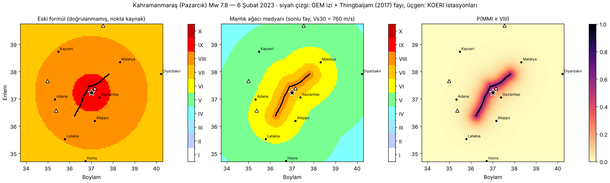
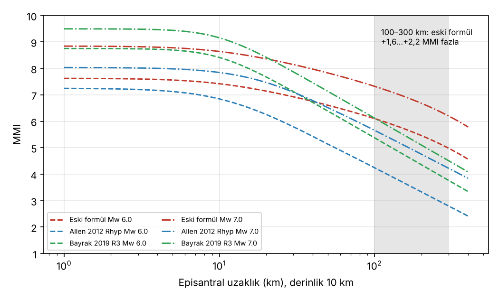
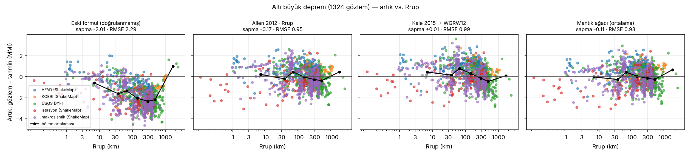
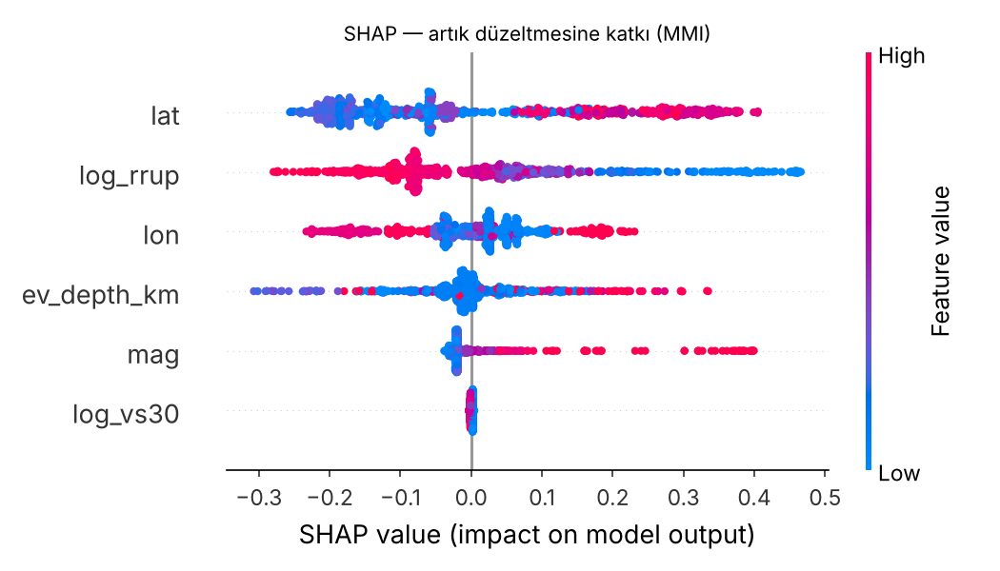

# 🌍 MMI Intensity Mapper — Deprem Şiddeti Haritalama

<p align="center">
  
  
  
  
  
  
</p>

<p align="center">
  <a href="notebooks/kahramanmaras_demo.ipynb"></a>
  <a href="app/streamlit_app.py"></a>
  <a href="docs/literatur_taramasi.pdf"></a>
  <a href="https://www.kaggle.com/memreu"></a>
</p>

Olmuş bir depremin büyüklüğü, konumu ve derinliğinden, farklı noktalarda sarsıntının **Değiştirilmiş Mercalli Şiddeti (MMI)** cinsinden nasıl hissedildiğini tahmin eden, Türkiye odaklı, açık ve tekrarlanabilir bir Python aracı. Yayımlanmış şiddet modellerini (IPE), OpenQuake üzerinden **GMPE + GMICE** zincirini, **sonlu fay** geometrisini, **zemin (Vs30)** etkisini, **belirsizlik** bantlarını ve gözlemle **doğrulamayı** tek bir pakette birleştirir.

> Bu araç **olmuş bir depremin etkisini** tahmin eder. Gelecekteki depremlerin zamanını, yerini ya da büyüklüğünü **tahmin etmez**.

<p align="center"></p>

> 🇬🇧 **In English:** A lightweight, documented and validated rapid-intensity tool for Türkiye. It replaces an unsourced legacy formula with published models: Allen, Wald & Worden (2012) and Bayrak et al. (2019) IPEs, plus a Kale et al. (2015) GMPE → Worden et al. (2012) / Bilal & Askan (2014) GMICE chain run through OpenQuake. Large events use a finite fault built from GEM active-fault traces and Thingbaijam et al. (2017) scaling. A four-branch logic tree yields 16/50/84th percentiles and P(MMI ≥ VII/VIII). Across six large earthquakes (Kahramanmaraş 2023 ×2, Elazığ 2020, Samos 2020, Düzce 1999, İzmit 1999; 1,324 USGS DYFI, field-intensity and strong-motion observations), the legacy formula over-predicts by **2.0 MMI** (RMSE 2.29), while the logic tree has a bias of **−0.11** (RMSE 0.93). Within 50 km of the fault, the automatically built GEM-based rupture (logic-tree RMSE 1.24) performs almost as well as the USGS rupture (1.17), whereas a point source gives 1.59; for Kahramanmaraş alone the values are 1.10, 1.07 and 2.26. A monotonic-constrained LightGBM residual model, validated with event-grouped CV, lowers out-of-fold RMSE from **0.68 to 0.45** across 949 records. Outputs include a PAGER-style population exposure table, a layered Folium map, a Streamlit app and CI tests that check the IPEs against OpenQuake.

<details>
<summary><b>📑 İçindekiler</b></summary>

- [Öne çıkan sonuçlar](#öne-çıkan-sonuçlar)
- [Neden yeniden yazıldı?](#neden-yeniden-yazıldı)
- [Yöntem](#yöntem)
- [Doğrulama sonuçları](#doğrulama-sonuçları)
- [Makine öğrenmesi: artık modeli](#makine-öğrenmesi-artık-modeli)
- [Nüfus maruziyeti](#nüfus-maruziyeti)
- [Kurulum ve çalıştırma](#kurulum-ve-çalıştırma)
- [Klasör yapısı](#klasör-yapısı)
- [Veri ve lisanslar](#veri-ve-lisanslar)
- [Sınırlılıklar ve sonraki adımlar](#sınırlılıklar-ve-sonraki-adımlar)
- [Kaynaklar](#kaynaklar)

</details>

## Öne çıkan sonuçlar

| | Sonuç |
|---|---|
| ❌ **Eski formül** | Kaynağı bulunamadı. Altı büyük depremde (1 324 gözlem) ortalama **2,0 MMI fazla** tahmin ediyor (RMSE 2,29); altı depremin hepsinde en kötü model |
| 📐 **Yerine gelen modeller** | Allen 2012 (Rrup/Rhyp), Bayrak 2019 (Türkiye), Kale 2015 → WGRW12 / Bilal & Askan 2014 |
| 🎯 **En iyi modeller** | Altı deprem: mantık ağacı sapma **−0,11**, RMSE **0,93**; Allen 2012 Rrup 0,95; Kale 2015 → WGRW12 0,99 · Kahramanmaraş: mantık ağacı ve Allen 2012 RMSE **0,88** |
| 🧭 **Sonlu fay** | Kahramanmaraş'ta faya 50 km içinde RMSE: nokta kaynak **2,26** → otomatik GEM fayı **1,10** ≈ USGS fayı **1,07** |
| 🎲 **Belirsizlik** | 4 dallı mantık ağacı · %16/%50/%84 · P(MMI ≥ VII), P(MMI ≥ VIII) haritaları |
| 🤖 **ML katkısı** | Monoton kısıtlı LightGBM artık modeli: katman dışı RMSE **0,68 → 0,45** (istasyon bazlı CV'de 0,49) |
| 🧱 **Zemin** | Her noktaya USGS Vs30 rasteri. ML artık modelinde Vs30'un ek katkısı neredeyse sıfır (|SHAP| ≈ 0,001); Allen vd. (2012) bulgusuyla uyumlu |
| 👥 **Maruziyet** | Kahramanmaraş Mw 7.8 senaryosunda medyan tahminle **5,3 milyon** kişi (≥ 15 000 nüfuslu yerleşimlerde) MMI ≥ VII |

## Neden yeniden yazıldı?

Projenin ilk sürümü `MMI = 1.62 + 1.22·Mw − 0.00255·R − 1.29·log10(R)` formülünü kullanıyordu. Literatür taramasında ([`docs/literatur_taramasi.pdf`](docs/literatur_taramasi.pdf)) bu formülün yayımlanmış bir kaynağı bulunamadı. Formül, Allen vd. (2012)'ye göre 100–300 km'de şiddeti **1,6–2,2 MMI** fazla tahmin ediyordu; gerçek gözlemler bunu doğruladı. Ayrıca:

- **Nokta kaynak varsayımı** büyük depremlerde çöküyordu (Mw 7.8 için Thingbaijam vd. 2017 medyan fay uzunluğu 234 km).
- **Zemin** ve **belirsizlik** hesapta yoktu.
- MMI'dan Mw'ye "geri dönüşüm" bilimsel olarak geçersizdi: büyüklük depremin, şiddet konumun özelliğidir. Bu fonksiyon kaldırıldı.

Eski formül, karşılaştırma amacıyla `legacy_unverified` adıyla ve "doğrulanmamış" etiketiyle tutuluyor.

<p align="center"></p>

## Yöntem

### Modeller

| Model | Tür | Girdiler | Katsayı kaynağı |
|---|---|---|---|
| Allen, Wald & Worden (2012) · Rrup | IPE (küresel) | Mw, Rrup | OpenQuake `AllenEtAl2012` |
| Allen, Wald & Worden (2012) · Rhyp | IPE (küresel) | Mw, Rhyp | OpenQuake `AllenEtAl2012Rhypo` |
| Bayrak, Nas & Bayrak (2019) · R3 | IPE (Türkiye) | Mw, Repi, derinlik | Makale, Tablo 4 (R1–R4 kodda) |
| Kale vd. (2015) → Worden vd. (2012) | GMPE + GMICE | Mw, Rjb, Vs30, rake | OpenQuake `KaleEtAl2015Turkey` + USGS `esi-shakelib` WGRW12 |
| Kale vd. (2015) → Bilal & Askan (2014) | GMPE + GMICE (Türkiye) | Mw, Rjb, Vs30, rake | OpenQuake + makale özeti |
| ~~Eski formül~~ | doğrulanmamış | Mw, Rhyp | — |

Katsayılar hafızadan yazılmadı. Testler Allen 2012 sonuçlarını OpenQuake ile 1e-10 hassasiyetinde, fay uzaklıklarını OpenQuake `PlanarSurface` ile 0,3 km içinde karşılaştırır.

### Kaynak geometrisi

- **Mw < 6.5:** nokta kaynak (Rjb ≈ Repi, Rrup ≈ Rhyp).
- **Mw ≥ 6.5:** sonlu fay. ShakeMap `rupture.json` ya da USGS FFM verilirse kullanılır; ancak uzunluğu Thingbaijam (2017) medyanının yarısından kısaysa reddedilir (bazı eski ShakeMap Atlas faylarında Mw 7.6 İzmit için yalnızca 15 km'lik tek parça vardır). Verilmezse episantr çevresindeki GEM Global Active Faults izleri uç uca zincirlenir ve episantrın izdüşümü etrafında Thingbaijam vd. (2017) ölçek yasasıyla L uzunluğunda (Mw 7.8 doğrultu atımlı için 234 km), W genişliğinde bir parça kesilir.
- Rjb, fay izdüşümüne olan uzaklıktır ve `shapely` ile hesaplanır. Rrup düşey faylarda `shapely` ile, eğimli faylarda 1 km aralıklı yüzey ağıyla hesaplanır.

### Zemin

Her noktaya USGS Global Vs30 Mosaic'ten `rasterio` ile Vs30 atanır. Türkiye ve çevresi için kırpılmış raster repoda hazırdır (`data/vs30/vs30_turkey.tif`, 24–46°D, 33–43,5°K, 30 yay saniyesi). Küresel ızgara için `scripts/download_data.py vs30` kullanılabilir. Raster dışındaki noktalarda 760 m/s referans değeri atanır ve kullanıcı uyarılır. Doğrulamada da tüm gözlem noktalarına aynı rasterden Vs30 atandı. ShakeMap istasyon listesindeki AFAD istasyonlarının ~%48'inde görülen 760 m/s değeri bir yer tutucudur: raster bu istasyonlar için 270–643 m/s (medyan 429) verir.

### Belirsizlik ve mantık ağacı

Her dal bir noktada MMI ~ N(μ, σ) verir. GMPE+GMICE zincirinde σ² = (dMMI/dlnPGV · σ_lnPGV)² + σ²_GMICE. Mantık ağacı dalların ağırlıklı karışımıdır. %16/%50/%84 değerleri karışımın ters dağılım fonksiyonundan, aşma olasılığı ise P(MMI ≥ k) = Σ wᵢ[1 − Φ((k − μᵢ)/σᵢ)] ile hesaplanır.

| Dal | Ağırlık | Sonlu fayda |
|---|---|---|
| Allen 2012 · Rrup | 0.30 | 0.35 |
| Kale 2015 → WGRW12 | 0.30 | 0.35 |
| Kale 2015 → Bilal & Askan 2014 | 0.20 | 0.24 |
| Bayrak 2019 · R3 | 0.20 | 0.06 (episantral uzaklık kullandığı için) |

Gerekçeler: [`docs/logic_tree.md`](docs/logic_tree.md).

## Doğrulama sonuçları

Artık = gözlem − tahmin; **negatif sapma, modelin fazla tahmin ettiğini** gösterir. Enstrümantal gözlemlerde PGV, Worden vd. (2012) ile MMI'ya çevrildi. Vs30 tüm noktalarda USGS rasterinden alındı. Tüm tablolar ve grafikler: [`results/`](results/README.md).

### Altı büyük deprem (1 324 gözlem)

Gözlemler USGS ComCat'ten alındı: **DYFI** (≥ 3 yanıt), ShakeMap istasyon listesindeki **AFAD, KOERI ve diğer ağların** PGV'leri ve ShakeMap'teki **makrosismik saha şiddetleri** (1999 depremleri, Sisam 2020 için EMSC). Fay sırasıyla ShakeMap → FFM → otomatik GEM olarak seçildi (`data/events.csv`).

| Deprem | Mw | Fay | N | Eski formül | Allen 2012 Rrup | Bayrak 2019 | Kale → WGRW12 | Mantık ağacı |
|---|---|---|---|---|---|---|---|---|
| Kahramanmaraş (Pazarcık) 2023 | 7.8 | ShakeMap, 286 km | 447 | 2,09 | 0,86 | 1,05 | 0,98 | **0,85** |
| Kahramanmaraş (Elbistan) 2023 | 7.5 | ShakeMap, 136 km | 136 | 1,99 | 0,95 | **0,87** | 1,16 | 0,99 |
| Elazığ (Sivrice) 2020 | 6.7 | ShakeMap, 37 km | 39 | 1,53 | 0,79 | **0,77** | 0,82 | 0,92 |
| Sisam / İzmir 2020 | 7.0 | FFM, 40 km | 491 | 2,64 | 0,95 | 1,39 | 0,93 | **0,87** |
| Düzce 1999 | 7.2 | GEM otomatik, 91 km | 86 | 2,06 | 1,18 | 1,21 | **1,11** | 1,21 |
| Kocaeli (İzmit) 1999 | 7.6 | FFM, 175 km | 125 | 2,08 | 1,11 | 1,40 | **1,05** | 1,12 |
| **Toplam (sapma · RMSE)** | | | 1 324 | −2,01 · 2,29 | −0,17 · 0,95 | −0,48 · 1,21 | +0,01 · 0,99 | **−0,11 · 0,93** |

<sub>Deprem satırlarında RMSE (MMI). Gözlem türüne göre ayrıntı: `results/metrics_six_events_by_obs_type.csv`.</sub>

<p align="center"></p>

**Kaynak geometrisi ne kadar önemli?** Aynı gözlemler, üç geometriyle (mantık ağacı ortalaması, RMSE):

| Geometri | Kahramanmaraş, tümü (583) | Kahramanmaraş, faya ≤ 50 km (65) | Altı deprem, faya ≤ 50 km (210) |
|---|---|---|---|
| Nokta kaynak | 1,18 | 2,26 | 1,59 |
| GEM izi + Thingbaijam 2017 (**otomatik**, dış veri gerektirmez) | 0,92 | 1,10 | 1,24 |
| USGS fayı (ShakeMap / FFM) | 0,88 | 1,07 | 1,17 |

### Kahramanmaraş 2023: gözlem türüne göre

| Model | DYFI (248) | AFAD (296) | KOERI (34) |
|---|---|---|---|
| Eski formül (doğrulanmamış) | −2,14 · 2,40 | −1,42 · 1,71 | −2,15 · 2,31 |
| Allen 2012 · Rrup | −0,31 · 0,96 | +0,44 · **0,82** | −0,09 · 0,81 |
| Bayrak 2019 · R3 | −0,30 · 1,03 | +0,46 · 1,02 | −0,22 · **0,76** |
| Kale 2015 → WGRW12 | −0,19 · 1,06 | +0,73 · 1,00 | +0,22 · 0,94 |
| Mantık ağacı (ortalama) | −0,25 · **0,95** | +0,49 · 0,83 | +0,09 · 0,82 |

<sub>Hücreler: sapma · RMSE (MMI). Tüm gözlemlerde (583): eski formül −1,77 · 2,07; Allen 2012 Rrup +0,08 · 0,88; mantık ağacı +0,15 · 0,88.</sub>

### Türkiye geneli (KOERI kuvvetli yer hareketi tablosu)

| Model | Mw ≥ 6 (18 deprem, 54 kayıt) | Tüm KOERI (332 deprem, 949 kayıt) |
|---|---|---|
| Eski formül (doğrulanmamış) | −2,36 · 2,45 | −2,64 · 2,69 |
| Allen 2012 · Rhyp | −0,61 · 0,89 | −0,59 · 0,77 |
| Allen 2012 · Rrup | −0,57 · 0,89 | −1,22 · 1,32 |
| Bayrak 2019 · R3 | −1,63 · 1,91 | −2,52 · 2,60 ¹ |
| **Kale 2015 → WGRW12** | **−0,17 · 0,69** | **−0,42 · 0,68** |
| Kale 2015 → Bilal & Askan 2014 | +0,20 · 0,96 | +0,73 · 1,06 |
| Mantık ağacı (ortalama) | −0,48 · 0,80 | −0,85 · 0,98 |

<sub>¹ Bayrak 2019, MMI ≥ 4 ve Mw ≥ 4.5 için türetildi; tüm-KOERI kümesinin büyük kısmı bu aralığın dışında.</sub>

**Bulgular**

1. **Eski formül altı depremin hepsinde açık ara en kötü model.** Ortalama 2 MMI fazla tahmin ediyor. Kahramanmaraş'ta fayın 25 km yakınında sapması küçük, ama 100–200 km'de −1,6'ya, 400 km ötesinde −2,4'e çıkıyor (`results/metrics_kahramanmaras_by_distance.csv`). Literatür taramasındaki "uzak mesafede 1,5–2 MMI fazla" tespiti gerçek gözlemlerle doğrulandı.
2. **Büyük depremde sonlu fay belirleyici.** Kahramanmaraş'ta fay yakınındaki RMSE nokta kaynakla 2,26'dan sonlu fayla 1,07–1,10'a iniyor. GEM izlerinden otomatik kurulan fay, USGS'in deprem sonrası yayımladığı faya neredeyse eşdeğer. Yani USGS ürünü yayımlanmadan önce de doğru bir harita üretilebilir. Düzce 1999'da USGS'in kullanılabilir bir fayı olmadığı için bu yol zorunluydu.
3. **Tek bir "en iyi" model yok; mantık ağacı en istikrarlı seçenek.** Deprem bazında en iyi model değişiyor: Allen, Bayrak ya da Kale zinciri. Mantık ağacı her depremde en iyi modelden en fazla 0,15 MMI uzakta kalıyor ve toplamda en düşük RMSE'yi veriyor. Bu, ağırlıklı birleştirmeyi destekleyen ampirik bir bulgu.
4. **Bayrak 2019 orta büyüklükte iyi, en büyük depremlerde zayıf.** Elazığ ve Elbistan'da en iyi model; ancak Sisam ve İzmit'te RMSE 1,4. Bu, episantral uzaklığın uzun ya da açık denizdeki faylarda yetersiz kalmasıyla uyumlu.
5. **Enstrümantal "gözlem" de bir modele bağlı.** Aynı PGV'ler Bilal & Askan ile MMI'ya çevrildiğinde RMSE 0,5–0,8 MMI artıyor (`results/sensitivity_observed_gmice.csv`). DYFI ve saha şiddetleri bu döngüselliği kırıyor; onlara karşı da sıralama değişmiyor (eski formül en kötü, mantık ağacı en iyiler arasında).

## Makine öğrenmesi: artık modeli

Literatürün önerdiği hibrit yapı uygulandı: `MMI = MMI_fizik + f_LightGBM(özellikler)`. Omurga Kale 2015 → WGRW12'dir. LightGBM `init_score` ile yalnızca artığı öğrenir. Mw (+), Rrup (−) ve Vs30 (−) üzerinde **monotonluk kısıtları** vardır, bu yüzden toplam tahmin fiziksel olarak tutarlı kalır. Doğrulama, deprem bazında gruplandırılmış 5 katlı **GroupKFold** ile yapıldı; gruplar, kayıt pencereleri örtüşen depremleri de birleştirir.

| Küme | Omurga | + sabit kaydırma | **+ LightGBM** |
|---|---|---|---|
| Tümü (deprem bazlı CV) | 0,68 | 0,54 | **0,45** |
| Tümü (istasyon bazlı CV) | 0,68 | 0,55 | **0,49** |
| Mw ≥ 6 | 0,69 | 0,71 | **0,65** |
| Rrup ≤ 50 km | 0,59 | 0,70 | **0,53** |

<sub>Katman dışı RMSE (MMI). Ayrıntı: [`results/ml/`](results/ml/README.md).</sub>

<p align="center"></p>

- Basit bir sabit düzeltme, küçük depremlerdeki genel sapmayı giderir ama **büyük depremleri ve yakın mesafeyi bozar**. LightGBM bunu büyüklüğe ve uzaklığa bağlı öğrendiği için bu sorunu yaşamaz.
- SHAP'a göre en büyük katkı konumdan (bölgesel yol ve istasyon etkileri) ve uzaklıktan geliyor. **Vs30'un ek bilgisi yok.** Bu, literatür taramasındaki "zemin düzeltmesinin etkisi belirsiz" boşluğuna ilk sayısal katkıdır.

## Nüfus maruziyeti

USGS PAGER mantığıyla, tahmin edilen MMI sınıflarına göre nüfus toplanır. Kahramanmaraş Mw 7.8 senaryosu (otomatik GEM fayı, USGS Vs30, episantrın ±3° çevresi, Suriye dahil):

| MMI | %16 | Medyan | %84 |
|---|---|---|---|
| IV | 9 643 450 | 489 383 | 0 |
| V | 10 518 798 | 9 179 461 | 1 034 302 |
| VI | 4 092 977 | 10 518 798 | 8 673 608 |
| VII | 1 202 885 | 4 005 583 | 9 597 135 |
| VIII | 0 | 1 290 279 | 4 831 667 |
| IX | 0 | 0 | 1 217 195 |
| X+ | 0 | 0 | 129 597 |

<sub>Nüfus: GeoNames ≥ 15 000 nüfuslu yerleşimler (kırsal nüfus hariç, bu yüzden PAGER değerlerinden düşüktür). GHSL ya da TÜİK rasteri `exposure(..., raster=...)` ile kullanılabilir. Tam tablo: `results/kahramanmaras_exposure.csv`.</sub>

Katmanlı harita (`results/kahramanmaras_map.html`) şu katmanları içerir: medyan, %16, %84, σ, P(≥VII), P(≥VIII), fay, istasyon gözlemleri ve yerleşimler.

## Kurulum ve çalıştırma

```bash
git clone https://github.com/Memreu/deprem-mesafe-etki-analizi.git
cd deprem-mesafe-etki-analizi
pip install -r requirements.txt
pip install --no-deps openquake.engine==3.26.2   # hazardlib; GDAL derlemesini atlamak için bağımlılıksız
pip install --no-deps -e .                       # mmi-mapper komutu
```

Bağımlılıklar `pyproject.toml`'da da tanımlı: `pip install -e ".[dev]"` (ML ve Streamlit dahil) ya da yalnızca çekirdek için `pip install -e .`. CI, Python 3.11, 3.12 ve 3.13'te çalışır.

**Komut satırı**

```bash
mmi-mapper                                      # etkileşimli (ondalık ya da DMS koordinat); python -m mmi_mapper de olur
mmi-mapper --mag 7.8 --lat 37.2256 --lon 37.0143 --depth 10 \
       --site 37.5753,36.9228 --site 36.2023,36.1613 --vs30 400
mmi-mapper --list-events                        # benchmark'taki altı deprem
mmi-mapper --event us6000jllz --site 37.5753,36.9228   # olay parametreleri ve USGS fayı data/events.csv'den
```

**Arayüz, not defteri ve çoğaltma**

```bash
streamlit run app/streamlit_app.py              # altı deprem, fay seçimi, harita, maruziyet, gözlem karşılaştırması
jupyter lab notebooks/kahramanmaras_demo.ipynb  # uçtan uca demo (çıktılarıyla)
python scripts/run_benchmark.py                 # Aşama 3: results/ tabloları ve grafikleri
python scripts/train_residual_model.py          # Aşama 4: LightGBM + SHAP
python scripts/make_figures.py                  # README görselleri, maruziyet tablosu, katmanlı harita
pytest -q                                       # 31 test (Streamlit arayüzü dahil)
```

**Ek veriyle genişletme**

```bash
python scripts/download_data.py usgs us6000jllz          # DYFI, ShakeMap istasyonları, rupture.json, FFM
python scripts/build_usgs_observations.py                # → data/events.csv, data/observations/usgs_observations.csv, data/ruptures/
python scripts/download_data.py vs30                     # USGS Global Vs30 Mosaic, küresel (~610 MB)
# AFAD TADAS tablosu → data/raw/us6000jllz/afad_stations.csv (station, lat, lon, pgv_cms)
# Saha haritası     → data/raw/us6000jllz/field_map.csv     (lat, lon, mmi)
```

Altı depremin USGS gözlemleri, fayları ve Türkiye Vs30 rasteri repoda hazır; benchmark ek indirme gerektirmez.

## Klasör yapısı

```
├── mmi_mapper/
│   ├── ipe.py                      # Allen 2012, Bayrak 2019, eski formül (doğrulanmamış)
│   ├── gmpe.py · gmice.py          # OpenQuake Kale 2015 · WGRW12, Bilal & Askan 2014
│   ├── rupture.py                  # Nokta / sonlu fay, GEM + Thingbaijam, Rjb–Rrup
│   ├── site.py                     # Vs30 rasteri, NEHRP sınıfı
│   ├── model.py · grid.py          # Senaryo ve ızgara hesabı
│   ├── uncertainty.py              # Mantık ağacı, çeyreklikler, aşma olasılığı
│   ├── observations.py · benchmark.py   # Gözlem yükleyicileri, metrikler, grafikler
│   ├── ml.py                       # LightGBM artık modeli
│   ├── events.py                   # Benchmark depremleri: olay tablosu, fay seçimi, gözlemler
│   ├── exposure.py · mapping.py    # PAGER tablosu, katmanlı folium haritası
│   └── cli.py · scale.py · coords.py
├── app/streamlit_app.py
├── notebooks/kahramanmaras_demo.ipynb
├── scripts/                        # benchmark, ML, görseller, veri indirme
├── data/faults/                    # GEM aktif fay izleri (CC BY-SA 4.0)
├── data/events.csv                 # Benchmark depremleri ve seçilen fay geometrisi
├── data/observations/              # KOERI kayıtları; altı depremin USGS DYFI, istasyon ve saha gözlemleri
├── data/ruptures/                  # USGS ShakeMap / FFM fay geometrileri
├── data/vs30/                      # USGS Vs30, Türkiye kırpımı
├── results/                        # Benchmark ve ML çıktıları
├── docs/                           # Literatür taraması, mantık ağacı
├── tests/                          # pytest (OpenQuake karşılaştırmaları dahil)
└── .github/workflows/tests.yml     # GitHub Actions
```

## Veri ve lisanslar

| Veri | Kaynak | Lisans |
|---|---|---|
| Aktif fay izleri | GEM Global Active Faults (Styron & Pagani 2020) | CC BY-SA 4.0 |
| Kuvvetli yer hareketi | KOERI / ORFEUS-EIDA, [turkiye-deprem-verisi](https://github.com/Ayberkrk/turkiye-deprem-verisi) üzerinden | Yalnızca akademik / ticari olmayan kullanım |
| DYFI, ShakeMap istasyonları (AFAD, KOERI vd.), saha şiddetleri ve faylar | USGS ComCat (altı deprem, `data/events.csv`) | Kamu malı |
| Vs30 rasteri | USGS Global Vs30 Mosaic (Türkiye kırpımı) | Kamu malı |
| Yerleşim nüfusu | GeoNames (`geonamescache`) | CC BY 4.0 |

Ayrıntılar: [`data/faults/README.md`](data/faults/README.md), [`data/observations/README.md`](data/observations/README.md).

## Sınırlılıklar ve sonraki adımlar

- **Saha haritası ve TADAS henüz yok.** Albayrak vd. (2024) saha şiddetleri ve TADAS'ın tam istasyon tablosu eklenmedi. `data/raw/<event_id>/` altına konduklarında benchmark onları otomatik olarak kullanır.
- **Makrosismik veriler karışık ölçekli olabilir.** ShakeMap'teki saha şiddetleri (1999 depremleri, Sisam 2020 için EMSC) olduğu gibi MMI kabul edildi; ölçek dönüşümü uygulanmadı.
- **İstasyon PGV bileşeni:** ShakeMap listesindeki PGV büyük yatay bileşendir, Kale 2015 ise geometrik ortalama verir. Bu, Kale zincirinin istasyonlara karşı pozitif sapmasının (~0,1–0,3 MMI) bir kısmını açıklar.
- **KOERI veri seti:** kaynak belgesine göre PGA'lar Akkar vd. (2014)'e göre log10'da ~0,24 düşük. Tüm-KOERI kümesindeki negatif sapmanın bir kısmı buradan gelebilir.
- **Kabul edilen varsayımlar:** Bayrak 2019'da log tabanı (log10) ve σY'nin toplam sigma olduğu; Bilal & Askan 2014 için σ_GMICE = 0,63 (WGRW12'den vekil); GEM izlerinde sağ el eğim kuralı; GMPE geometrik ortalama bileşeni ile GMICE bileşeni arasında dönüşüm yapılmaması.
- **Yakın alan:** Kahramanmaraş'ta faya 10 km içindeki 15 istasyonda gözlenen ortalama 9,0, mantık ağacı medyanı 8,3. Yönelim (directivity) ve havza etkileri modelde yok.
- **Sonraki adımlar:** ML artık modelini altı depremin DYFI ve saha verisiyle genişletmek; kalan artıklar için uzamsal Gauss süreci; bu 1 324 gözlemle Türkiye için Rrup tabanlı bir IPE kalibre etmek (literatür boşluğu #2) ve gözlemleri açık bir Türkiye şiddet veri seti olarak yayımlamak (boşluk #1).

## Kaynaklar

- Allen, T.I., Wald, D.J., Worden, C.B. (2012). Intensity attenuation for active crustal regions. *J. Seismology* 16, 409–433. doi:10.1007/s10950-012-9278-7
- Bayrak, E., Nas, M., Bayrak, Y. (2019). New macroseismic intensity predictive models for Turkey. *Acta Geophysica* 67, 1483–1513. doi:10.1007/s11600-019-00357-4
- Kale, Ö., Akkar, S., Ansari, A., Hamzehloo, H. (2015). A ground-motion predictive model for Iran and Turkey. *BSSA* 105(2A), 963–980.
- Worden, C.B., Gerstenberger, M.C., Rhoades, D.A., Wald, D.J. (2012). Probabilistic relationships between ground-motion parameters and MMI in California. *BSSA* 102(1), 204–221. doi:10.1785/0120110156
- Bilal, M., Askan, A. (2014). Relationships between felt intensity and recorded ground-motion parameters for Turkey. *BSSA* 104(1), 484–496. doi:10.1785/0120130093
- Thingbaijam, K.K.S., Mai, P.M., Goda, K. (2017). New empirical earthquake source-scaling laws. *BSSA* 107(5), 2225–2246. doi:10.1785/0120170017
- Styron, R., Pagani, M. (2020). The GEM Global Active Faults Database. *Earthquake Spectra* 36(S1), 160–180. doi:10.1177/8755293020944182
- Jaiswal, K., Wald, D.J. (2010). An empirical model for global earthquake fatality estimation. *Earthquake Spectra* 26(4), 1017–1037.
- Pagani, M. vd. (2014). OpenQuake Engine: an open hazard (and risk) software for the Global Earthquake Model. *SRL* 85(3), 692–702.
- Tam kaynakça: [`docs/literatur_taramasi.pdf`](docs/literatur_taramasi.pdf)

---

Bu proje [MIT lisansı](LICENSE) ile paylaşılmaktadır. `data/` altındaki veriler kendi lisanslarına tabidir.

**Mehmet Emre Ünlü** · [GitHub](https://github.com/Memreu) · [LinkedIn](https://www.linkedin.com/in/memreu) · [Kaggle](https://www.kaggle.com/memreu)
