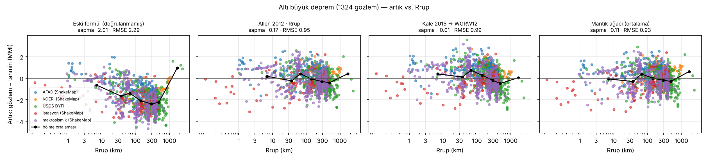
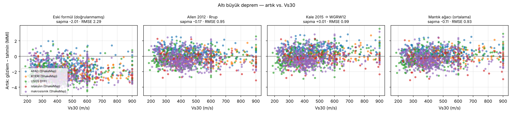
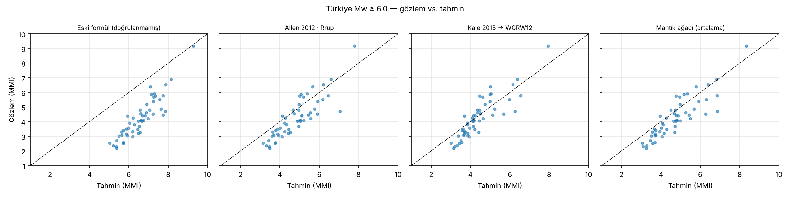

# Benchmark sonuçları

Otomatik üretilmiştir: `python scripts/run_benchmark.py`. Artık = gözlem − tahmin (MMI);
negatif sapma modelin fazla tahmin ettiğini gösterir. Enstrümantal gözlemlerde PGV, Worden vd. (2012)
ile MMI'ya çevrilmiştir. Vs30 tüm noktalarda USGS Global Vs30 rasterinden alınmıştır.

## 1. Kahramanmaraş 2023

Gözlemler: AFAD (ShakeMap): 296, USGS DYFI: 248, KOERI (ShakeMap): 34, istasyon (ShakeMap): 5.

- us6000jllz (Kahramanmaraş (Pazarcık) 2023): us6000jllz_shakemap.geojson, L = 286 km
- us6000jlqa (Kahramanmaraş (Elbistan) 2023): us6000jlqa_shakemap.geojson, L = 136 km

| model | N | sapma | RMSE | MAE |
|---|---|---|---|---|
| Eski formül (doğrulanmamış) | 583 | -1.77 | 2.07 | 1.86 |
| Allen 2012 · Rhyp | 583 | -0.08 | 1.05 | 0.84 |
| Allen 2012 · Rrup | 583 | +0.08 | 0.88 | 0.72 |
| Bayrak 2019 · R3 | 583 | +0.09 | 1.01 | 0.79 |
| Kale 2015 → WGRW12 | 583 | +0.30 | 1.02 | 0.83 |
| Kale 2015 → Bilal & Askan 2014 | 583 | +0.02 | 0.90 | 0.72 |
| Mantık ağacı (ortalama) | 583 | +0.15 | 0.88 | 0.71 |

### Gözlem türüne göre

| grup | model | N | sapma | RMSE |
|---|---|---|---|---|
| AFAD (ShakeMap) | Eski formül (doğrulanmamış) | 296 | -1.42 | 1.71 |
| AFAD (ShakeMap) | Allen 2012 · Rrup | 296 | +0.44 | 0.82 |
| AFAD (ShakeMap) | Bayrak 2019 · R3 | 296 | +0.46 | 1.02 |
| AFAD (ShakeMap) | Kale 2015 → WGRW12 | 296 | +0.73 | 1.00 |
| AFAD (ShakeMap) | Mantık ağacı (ortalama) | 296 | +0.49 | 0.83 |
| KOERI (ShakeMap) | Eski formül (doğrulanmamış) | 34 | -2.15 | 2.31 |
| KOERI (ShakeMap) | Allen 2012 · Rrup | 34 | -0.09 | 0.81 |
| KOERI (ShakeMap) | Bayrak 2019 · R3 | 34 | -0.22 | 0.76 |
| KOERI (ShakeMap) | Kale 2015 → WGRW12 | 34 | +0.22 | 0.94 |
| KOERI (ShakeMap) | Mantık ağacı (ortalama) | 34 | +0.09 | 0.82 |
| USGS DYFI | Eski formül (doğrulanmamış) | 248 | -2.14 | 2.40 |
| USGS DYFI | Allen 2012 · Rrup | 248 | -0.31 | 0.96 |
| USGS DYFI | Bayrak 2019 · R3 | 248 | -0.30 | 1.03 |
| USGS DYFI | Kale 2015 → WGRW12 | 248 | -0.19 | 1.06 |
| USGS DYFI | Mantık ağacı (ortalama) | 248 | -0.25 | 0.95 |
| istasyon (ShakeMap) | Eski formül (doğrulanmamış) | 5 | -1.86 | 2.14 |
| istasyon (ShakeMap) | Allen 2012 · Rrup | 5 | +0.13 | 0.84 |
| istasyon (ShakeMap) | Bayrak 2019 · R3 | 5 | -0.15 | 0.59 |
| istasyon (ShakeMap) | Kale 2015 → WGRW12 | 5 | +0.39 | 0.88 |
| istasyon (ShakeMap) | Mantık ağacı (ortalama) | 5 | +0.29 | 0.71 |

### Kaynak geometrisi duyarlılığı

Aynı gözlemler, üç kaynak geometrisiyle. `RMSE_yakın`: USGS fayına Rjb ≤ 50 km olan noktalar.

| geometri | model | N | sapma | RMSE | N_yakın | RMSE_yakın |
|---|---|---|---|---|---|---|
| Nokta kaynak | Allen 2012 · Rrup | 583 | +0.47 | 1.20 | 65 | 2.35 |
| Nokta kaynak | Kale 2015 → WGRW12 | 583 | +0.65 | 1.39 | 65 | 2.73 |
| Nokta kaynak | Mantık ağacı (ortalama) | 583 | +0.47 | 1.18 | 65 | 2.26 |
| GEM izi + Thingbaijam 2017 (otomatik) | Allen 2012 · Rrup | 583 | +0.11 | 0.91 | 65 | 1.19 |
| GEM izi + Thingbaijam 2017 (otomatik) | Kale 2015 → WGRW12 | 583 | +0.32 | 1.05 | 65 | 1.37 |
| GEM izi + Thingbaijam 2017 (otomatik) | Mantık ağacı (ortalama) | 583 | +0.17 | 0.91 | 65 | 1.10 |
| USGS fayı (ShakeMap / FFM; yoksa GEM) | Allen 2012 · Rrup | 583 | +0.08 | 0.88 | 65 | 1.15 |
| USGS fayı (ShakeMap / FFM; yoksa GEM) | Kale 2015 → WGRW12 | 583 | +0.30 | 1.02 | 65 | 1.36 |
| USGS fayı (ShakeMap / FFM; yoksa GEM) | Mantık ağacı (ortalama) | 583 | +0.15 | 0.88 | 65 | 1.07 |

## 2. Altı büyük deprem (1324 gözlem)

Fay seçimi: ShakeMap `rupture.json` → USGS FFM → GEM otomatik. Bir USGS dosyası, uzunluğu
Thingbaijam vd. (2017) medyanının en az yarısıysa kabul edilir (bazı eski ShakeMap Atlas fayları
yalnızca 5–20 km'lik tek parçadır).

- Kahramanmaraş (Pazarcık) 2023 (Mw 7.8, `us6000jllz`): us6000jllz_shakemap.geojson, L = 286 km; AFAD (ShakeMap): 241, USGS DYFI: 186, KOERI (ShakeMap): 16, istasyon (ShakeMap): 4
- Kahramanmaraş (Elbistan) 2023 (Mw 7.5, `us6000jlqa`): us6000jlqa_shakemap.geojson, L = 136 km; USGS DYFI: 62, AFAD (ShakeMap): 55, KOERI (ShakeMap): 18, istasyon (ShakeMap): 1
- Elazığ (Sivrice) 2020 (Mw 6.7, `us60007ewc`): us60007ewc_shakemap.geojson, L = 37 km; KOERI (ShakeMap): 21, USGS DYFI: 18
- Sisam / İzmir 2020 (Mw 7.0, `us7000c7y0`): us7000c7y0_ffm.geojson, L = 40 km; makrosismik (ShakeMap): 325, USGS DYFI: 61, KOERI (ShakeMap): 53, istasyon (ShakeMap): 52
- Düzce 1999 (Mw 7.2, `usp0009hev`): GEM GAF-DB izi (ME_TRCS010) + Thingbaijam 2017, L = 91 km; istasyon (ShakeMap): 55, makrosismik (ShakeMap): 31
- Kocaeli (İzmit) 1999 (Mw 7.6, `usp0009d4z`): usp0009d4z_ffm.geojson, L = 175 km; makrosismik (ShakeMap): 91, istasyon (ShakeMap): 34

| model | N | sapma | RMSE | MAE |
|---|---|---|---|---|
| Eski formül (doğrulanmamış) | 1324 | -2.01 | 2.29 | 2.07 |
| Allen 2012 · Rhyp | 1324 | -0.28 | 1.05 | 0.87 |
| Allen 2012 · Rrup | 1324 | -0.17 | 0.95 | 0.78 |
| Bayrak 2019 · R3 | 1324 | -0.48 | 1.21 | 0.99 |
| Kale 2015 → WGRW12 | 1324 | +0.01 | 0.99 | 0.80 |
| Kale 2015 → Bilal & Askan 2014 | 1324 | -0.11 | 1.07 | 0.82 |
| Mantık ağacı (ortalama) | 1324 | -0.11 | 0.93 | 0.75 |

### Deprem bazında RMSE

| Deprem | N | Eski formül (doğrulanmamış) | Allen 2012 · Rrup | Bayrak 2019 · R3 | Kale 2015 → WGRW12 | Mantık ağacı (ortalama) |
|---|---|---|---|---|---|---|
| Kahramanmaraş (Pazarcık) 2023 | 447 | 2.09 | 0.86 | 1.05 | 0.98 | 0.85 |
| Kahramanmaraş (Elbistan) 2023 | 136 | 1.99 | 0.95 | 0.87 | 1.16 | 0.99 |
| Elazığ (Sivrice) 2020 | 39 | 1.53 | 0.79 | 0.77 | 0.82 | 0.92 |
| Sisam / İzmir 2020 | 491 | 2.64 | 0.95 | 1.39 | 0.93 | 0.87 |
| Düzce 1999 | 86 | 2.06 | 1.18 | 1.21 | 1.11 | 1.21 |
| Kocaeli (İzmit) 1999 | 125 | 2.08 | 1.11 | 1.40 | 1.05 | 1.12 |

### Gözlem türüne göre

| grup | model | N | sapma | RMSE |
|---|---|---|---|---|
| DYFI | Eski formül (doğrulanmamış) | 327 | -2.18 | 2.42 |
| DYFI | Allen 2012 · Rrup | 327 | -0.33 | 0.96 |
| DYFI | Bayrak 2019 · R3 | 327 | -0.49 | 1.13 |
| DYFI | Kale 2015 → WGRW12 | 327 | -0.21 | 1.04 |
| DYFI | Mantık ağacı (ortalama) | 327 | -0.26 | 0.94 |
| enstrümantal | Eski formül (doğrulanmamış) | 550 | -1.75 | 2.00 |
| enstrümantal | Allen 2012 · Rrup | 550 | +0.10 | 0.85 |
| enstrümantal | Bayrak 2019 · R3 | 550 | -0.08 | 1.06 |
| enstrümantal | Kale 2015 → WGRW12 | 550 | +0.34 | 0.92 |
| enstrümantal | Mantık ağacı (ortalama) | 550 | +0.18 | 0.86 |
| makrosismik | Eski formül (doğrulanmamış) | 447 | -2.21 | 2.50 |
| makrosismik | Allen 2012 · Rrup | 447 | -0.37 | 1.05 |
| makrosismik | Bayrak 2019 · R3 | 447 | -0.96 | 1.42 |
| makrosismik | Kale 2015 → WGRW12 | 447 | -0.24 | 1.03 |
| makrosismik | Mantık ağacı (ortalama) | 447 | -0.35 | 0.99 |

### Kaynak geometrisi duyarlılığı (altı deprem)

| geometri | model | N | sapma | RMSE | N_yakın | RMSE_yakın |
|---|---|---|---|---|---|---|
| Nokta kaynak | Allen 2012 · Rrup | 1324 | +0.15 | 1.10 | 210 | 1.71 |
| Nokta kaynak | Kale 2015 → WGRW12 | 1324 | +0.29 | 1.21 | 210 | 1.89 |
| Nokta kaynak | Mantık ağacı (ortalama) | 1324 | +0.11 | 1.07 | 210 | 1.59 |
| GEM izi + Thingbaijam 2017 (otomatik) | Allen 2012 · Rrup | 1324 | -0.16 | 0.98 | 210 | 1.25 |
| GEM izi + Thingbaijam 2017 (otomatik) | Kale 2015 → WGRW12 | 1324 | +0.06 | 1.01 | 210 | 1.24 |
| GEM izi + Thingbaijam 2017 (otomatik) | Mantık ağacı (ortalama) | 1324 | -0.06 | 0.95 | 210 | 1.24 |
| USGS fayı (ShakeMap / FFM; yoksa GEM) | Allen 2012 · Rrup | 1324 | -0.17 | 0.95 | 210 | 1.18 |
| USGS fayı (ShakeMap / FFM; yoksa GEM) | Kale 2015 → WGRW12 | 1324 | +0.01 | 0.99 | 210 | 1.18 |
| USGS fayı (ShakeMap / FFM; yoksa GEM) | Mantık ağacı (ortalama) | 1324 | -0.11 | 0.93 | 210 | 1.17 |

## 3. Türkiye Mw ≥ 6.0 — KOERI (18 deprem, 54 kayıt)

Fay: Mw ≥ 6.5 için GEM otomatik, daha küçükler nokta kaynak. PGV geometrik ortalama.

| model | N | sapma | RMSE | MAE |
|---|---|---|---|---|
| Eski formül (doğrulanmamış) | 54 | -2.36 | 2.45 | 2.36 |
| Allen 2012 · Rhyp | 54 | -0.61 | 0.89 | 0.77 |
| Allen 2012 · Rrup | 54 | -0.57 | 0.89 | 0.78 |
| Bayrak 2019 · R3 | 54 | -1.63 | 1.91 | 1.73 |
| Kale 2015 → WGRW12 | 54 | -0.17 | 0.69 | 0.57 |
| Kale 2015 → Bilal & Askan 2014 | 54 | +0.20 | 0.96 | 0.78 |
| Mantık ağacı (ortalama) | 54 | -0.48 | 0.80 | 0.69 |

## 4. Tüm KOERI kayıtları (332 deprem, 949 kayıt)

| model | N | sapma | RMSE | MAE |
|---|---|---|---|---|
| Eski formül (doğrulanmamış) | 949 | -2.64 | 2.69 | 2.64 |
| Allen 2012 · Rhyp | 949 | -0.59 | 0.77 | 0.65 |
| Allen 2012 · Rrup | 949 | -1.22 | 1.32 | 1.23 |
| Bayrak 2019 · R3 | 949 | -2.52 | 2.60 | 2.52 |
| Kale 2015 → WGRW12 | 949 | -0.42 | 0.68 | 0.57 |
| Kale 2015 → Bilal & Askan 2014 | 949 | +0.73 | 1.06 | 0.77 |
| Mantık ağacı (ortalama) | 949 | -0.85 | 0.98 | 0.87 |

## 5. Duyarlılık: enstrümantal gözlemin GMICE seçimi

Enstrümantal 'gözlem' de bir dönüşüm denklemine bağlıdır. Aynı PGV kayıtları WGRW12 ve
Bilal & Askan 2014 ile MMI'ya çevrildiğinde metrikler aşağıdaki gibi değişir.

| küme | model | gözlem_GMICE | N | sapma | RMSE |
|---|---|---|---|---|---|
| Altı deprem (enstrümantal) | Allen 2012 · Rrup | WGRW12 | 550 | +0.10 | 0.85 |
| Altı deprem (enstrümantal) | Allen 2012 · Rrup | Bilal & Askan | 550 | +0.34 | 1.60 |
| Altı deprem (enstrümantal) | Kale 2015 → WGRW12 | WGRW12 | 550 | +0.34 | 0.92 |
| Altı deprem (enstrümantal) | Kale 2015 → WGRW12 | Bilal & Askan | 550 | +0.58 | 1.73 |
| Altı deprem (enstrümantal) | Kale 2015 → Bilal & Askan 2014 | WGRW12 | 550 | +0.12 | 1.10 |
| Altı deprem (enstrümantal) | Kale 2015 → Bilal & Askan 2014 | Bilal & Askan | 550 | +0.36 | 1.40 |
| Altı deprem (enstrümantal) | Mantık ağacı (ortalama) | WGRW12 | 550 | +0.18 | 0.86 |
| Altı deprem (enstrümantal) | Mantık ağacı (ortalama) | Bilal & Askan | 550 | +0.42 | 1.56 |
| KOERI Mw ≥ 6 | Allen 2012 · Rrup | WGRW12 | 54 | -0.57 | 0.89 |
| KOERI Mw ≥ 6 | Allen 2012 · Rrup | Bilal & Askan | 54 | -1.08 | 1.92 |
| KOERI Mw ≥ 6 | Kale 2015 → WGRW12 | WGRW12 | 54 | -0.17 | 0.69 |
| KOERI Mw ≥ 6 | Kale 2015 → WGRW12 | Bilal & Askan | 54 | -0.69 | 1.76 |
| KOERI Mw ≥ 6 | Kale 2015 → Bilal & Askan 2014 | WGRW12 | 54 | +0.20 | 0.96 |
| KOERI Mw ≥ 6 | Kale 2015 → Bilal & Askan 2014 | Bilal & Askan | 54 | -0.32 | 1.17 |
| KOERI Mw ≥ 6 | Mantık ağacı (ortalama) | WGRW12 | 54 | -0.48 | 0.80 |
| KOERI Mw ≥ 6 | Mantık ağacı (ortalama) | Bilal & Askan | 54 | -1.00 | 1.81 |

## Sınırlamalar

- ShakeMap istasyon PGV'leri büyük yatay bileşendir; Kale 2015 geometrik ortalama verir (≈0,1–0,3 MMI).
- Makrosismik saha şiddetleri ShakeMap'teki haliyle kullanıldı (1999 depremlerinin gözlenen
  şiddetleri, Sisam 2020 için EMSC); ölçek dönüşümü uygulanmadı.
- Düzce 1999 için USGS FFM yok ve ShakeMap Atlas fayı 5 km'lik tek parça; GEM otomatik fay kullanıldı.
- Albayrak vd. (2024) saha haritası ve TADAS tabloları dahil değildir (`data/raw/<event_id>/`).
- KOERI veri setinin PGA'ları kaynak belgesine göre Akkar vd. (2014)'e kıyasla log10'da ~0,24 düşüktür.
- Bayrak 2019, MMI ≥ 4 ve Mw ≥ 4.5 için türetilmiştir; tüm-KOERI kümesinin çoğu bu aralığın dışındadır.
