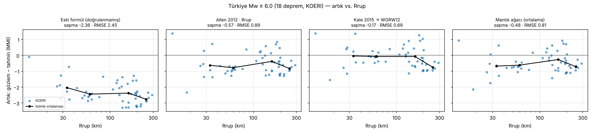
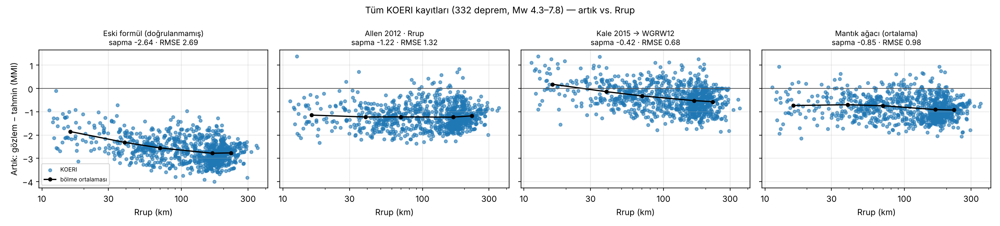
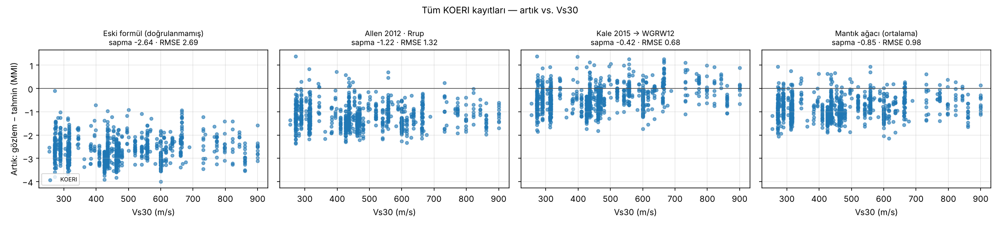

# Benchmark sonuçları

Otomatik üretilmiştir: `python scripts/run_benchmark.py`. Artık = gözlem − tahmin (MMI).
Enstrümantal gözlemler PGV'den Worden vd. (2012) ile MMI'ya çevrilmiştir.

## 1. Kahramanmaraş 2023

Gözlemler: AFAD (ShakeMap): 296, USGS DYFI: 248, KOERI: 8.

DYFI: `cdi_geo.txt`, en az 3 yanıt, şüpheli hücreler hariç. AFAD: ShakeMap istasyon listesindeki TK
ağı istasyonları (aykırı işaretliler hariç; PGV büyük yatay bileşen). Vs30: istasyonlarda ShakeMap/KOERI
değeri, DYFI hücrelerinde ShakeMap listesindeki en yakın noktanın (≤ 7 km) değeri.

- us6000jllz (Pazarcık Mw 7.8): us6000jllz_shakemap_rupture.json, L = 286 km
- us6000jlqa (Elbistan Mw 7.5): us6000jlqa_shakemap_rupture.json, L = 136 km

| model | N | sapma | RMSE | MAE |
|---|---|---|---|---|
| Eski formül (doğrulanmamış) | 552 | -1.75 | 2.05 | 1.84 |
| Allen 2012 · Rhyp | 552 | -0.06 | 1.05 | 0.83 |
| Allen 2012 · Rrup | 552 | +0.10 | 0.89 | 0.71 |
| Bayrak 2019 · R3 | 552 | +0.11 | 1.02 | 0.80 |
| Kale 2015 → WGRW12 | 552 | +0.48 | 1.04 | 0.85 |
| Kale 2015 → Bilal & Askan 2014 | 552 | +0.46 | 1.07 | 0.87 |
| Mantık ağacı (ortalama) | 552 | +0.32 | 0.90 | 0.73 |

### Gözlem türüne göre

| grup | model | N | sapma | RMSE |
|---|---|---|---|---|
| AFAD (ShakeMap) | Eski formül (doğrulanmamış) | 296 | -1.42 | 1.71 |
| AFAD (ShakeMap) | Allen 2012 · Rrup | 296 | +0.44 | 0.82 |
| AFAD (ShakeMap) | Bayrak 2019 · R3 | 296 | +0.46 | 1.02 |
| AFAD (ShakeMap) | Kale 2015 → WGRW12 | 296 | +0.87 | 1.11 |
| AFAD (ShakeMap) | Mantık ağacı (ortalama) | 296 | +0.63 | 0.93 |
| KOERI | Eski formül (doğrulanmamış) | 8 | -1.60 | 1.81 |
| KOERI | Allen 2012 · Rrup | 8 | +0.40 | 0.77 |
| KOERI | Bayrak 2019 · R3 | 8 | +0.12 | 0.64 |
| KOERI | Kale 2015 → WGRW12 | 8 | +0.70 | 0.93 |
| KOERI | Mantık ağacı (ortalama) | 8 | +0.40 | 0.72 |
| USGS DYFI | Eski formül (doğrulanmamış) | 248 | -2.14 | 2.40 |
| USGS DYFI | Allen 2012 · Rrup | 248 | -0.31 | 0.96 |
| USGS DYFI | Bayrak 2019 · R3 | 248 | -0.30 | 1.03 |
| USGS DYFI | Kale 2015 → WGRW12 | 248 | +0.01 | 0.95 |
| USGS DYFI | Mantık ağacı (ortalama) | 248 | -0.05 | 0.85 |

### Kaynak geometrisi duyarlılığı

Aynı gözlemler, üç kaynak geometrisiyle. `RMSE_fay_50km`: USGS fayına Rjb ≤ 50 km olan noktalar.

| geometri | model | N | sapma | RMSE | RMSE_fay_50km |
|---|---|---|---|---|---|
| Nokta kaynak | Allen 2012 · Rrup | 552 | +0.50 | 1.22 | 2.36 |
| Nokta kaynak | Kale 2015 → WGRW12 | 552 | +0.83 | 1.42 | 2.71 |
| Nokta kaynak | Mantık ağacı (ortalama) | 552 | +0.63 | 1.22 | 2.26 |
| GEM izi + Thingbaijam 2017 (otomatik) | Allen 2012 · Rrup | 552 | +0.13 | 0.91 | 1.18 |
| GEM izi + Thingbaijam 2017 (otomatik) | Kale 2015 → WGRW12 | 552 | +0.50 | 1.06 | 1.34 |
| GEM izi + Thingbaijam 2017 (otomatik) | Mantık ağacı (ortalama) | 552 | +0.35 | 0.93 | 1.09 |
| USGS ShakeMap fayı | Allen 2012 · Rrup | 552 | +0.10 | 0.89 | 1.14 |
| USGS ShakeMap fayı | Kale 2015 → WGRW12 | 552 | +0.48 | 1.04 | 1.33 |
| USGS ShakeMap fayı | Mantık ağacı (ortalama) | 552 | +0.32 | 0.90 | 1.05 |

## 2. Türkiye Mw ≥ 6.0 (18 deprem, 54 kayıt)

| model | N | sapma | RMSE | MAE |
|---|---|---|---|---|
| Eski formül (doğrulanmamış) | 54 | -2.36 | 2.45 | 2.36 |
| Allen 2012 · Rhyp | 54 | -0.61 | 0.89 | 0.77 |
| Allen 2012 · Rrup | 54 | -0.57 | 0.89 | 0.78 |
| Bayrak 2019 · R3 | 54 | -1.63 | 1.91 | 1.73 |
| Kale 2015 → WGRW12 | 54 | -0.17 | 0.69 | 0.58 |
| Kale 2015 → Bilal & Askan 2014 | 54 | +0.20 | 0.95 | 0.78 |
| Mantık ağacı (ortalama) | 54 | -0.48 | 0.81 | 0.69 |

## 3. Tüm KOERI kayıtları (332 deprem, 949 kayıt)

| model | N | sapma | RMSE | MAE |
|---|---|---|---|---|
| Eski formül (doğrulanmamış) | 949 | -2.64 | 2.69 | 2.64 |
| Allen 2012 · Rhyp | 949 | -0.59 | 0.77 | 0.65 |
| Allen 2012 · Rrup | 949 | -1.22 | 1.32 | 1.23 |
| Bayrak 2019 · R3 | 949 | -2.52 | 2.60 | 2.52 |
| Kale 2015 → WGRW12 | 949 | -0.42 | 0.68 | 0.57 |
| Kale 2015 → Bilal & Askan 2014 | 949 | +0.73 | 1.06 | 0.77 |
| Mantık ağacı (ortalama) | 949 | -0.85 | 0.98 | 0.87 |

## 4. Duyarlılık: enstrümantal gözlemin GMICE seçimi

Enstrümantal 'gözlem' de bir dönüşüm denklemine bağlıdır. Aşağıdaki tablo aynı PGV kayıtlarının
WGRW12 ve Bilal & Askan 2014 ile MMI'ya çevrilmesinin metrikleri nasıl değiştirdiğini gösterir.

| küme | model | gözlem_GMICE | N | sapma | RMSE |
|---|---|---|---|---|---|
| Kahramanmaraş (enstrümantal) | Allen 2012 · Rrup | WGRW12 | 304 | +0.44 | 0.82 |
| Kahramanmaraş (enstrümantal) | Allen 2012 · Rrup | Bilal & Askan | 304 | +1.21 | 1.55 |
| Kahramanmaraş (enstrümantal) | Kale 2015 → WGRW12 | WGRW12 | 304 | +0.87 | 1.10 |
| Kahramanmaraş (enstrümantal) | Kale 2015 → WGRW12 | Bilal & Askan | 304 | +1.64 | 1.90 |
| Kahramanmaraş (enstrümantal) | Kale 2015 → Bilal & Askan 2014 | WGRW12 | 304 | +0.57 | 1.12 |
| Kahramanmaraş (enstrümantal) | Kale 2015 → Bilal & Askan 2014 | Bilal & Askan | 304 | +1.34 | 1.68 |
| Kahramanmaraş (enstrümantal) | Mantık ağacı (ortalama) | WGRW12 | 304 | +0.62 | 0.93 |
| Kahramanmaraş (enstrümantal) | Mantık ağacı (ortalama) | Bilal & Askan | 304 | +1.39 | 1.67 |
| Mw ≥ 6 | Allen 2012 · Rrup | WGRW12 | 54 | -0.57 | 0.89 |
| Mw ≥ 6 | Allen 2012 · Rrup | Bilal & Askan | 54 | -1.08 | 1.92 |
| Mw ≥ 6 | Kale 2015 → WGRW12 | WGRW12 | 54 | -0.17 | 0.69 |
| Mw ≥ 6 | Kale 2015 → WGRW12 | Bilal & Askan | 54 | -0.68 | 1.77 |
| Mw ≥ 6 | Kale 2015 → Bilal & Askan 2014 | WGRW12 | 54 | +0.20 | 0.95 |
| Mw ≥ 6 | Kale 2015 → Bilal & Askan 2014 | Bilal & Askan | 54 | -0.32 | 1.17 |
| Mw ≥ 6 | Mantık ağacı (ortalama) | WGRW12 | 54 | -0.48 | 0.81 |
| Mw ≥ 6 | Mantık ağacı (ortalama) | Bilal & Askan | 54 | -1.00 | 1.82 |

## Sınırlamalar

- AFAD gözlemleri ShakeMap istasyon listesindeki PGV'lerdir (büyük yatay bileşen); Kale 2015 geometrik
  ortalama verir. Bu fark Kale zincirinin AFAD'a karşı pozitif sapmasının (~0,1–0,3 MMI) bir kısmını açıklar.
- ShakeMap istasyon listesindeki AFAD istasyonlarının yaklaşık yarısında Vs30 = 760 m/s (ShakeMap'in
  atadığı değer) görünür; bu, zemin büyütmesini düşük tahmin ettirebilir.
- Albayrak vd. (2024) saha haritası ve TADAS tabloları henüz dahil değildir (`data/raw/<event_id>/`).
- Kaynak veri setinin belgelerine göre KOERI PGA değerleri Akkar vd. (2014)'e kıyasla log10'da
  ~0,24 düşüktür; bu, özellikle tüm-KOERI kümesindeki negatif sapmanın bir kısmını açıklayabilir.
- Bayrak 2019, MMI ≥ 4 ve Mw ≥ 4.5 için türetilmiştir. Tüm-KOERI kümesindeki küçük depremler ve
  düşük şiddetler bu aralığın dışındadır.
- Enstrümantal gözlem GMICE'ye bağlıdır (bkz. bölüm 4); DYFI bu döngüselliği kırar.
