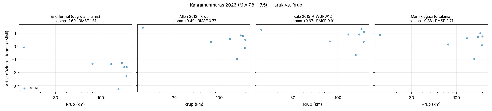

# Benchmark sonuçları

Otomatik üretilmiştir: `python scripts/run_benchmark.py`. Artık = gözlem − tahmin (MMI).
Enstrümantal gözlemler PGV'den Worden vd. (2012) ile MMI'ya çevrilmiştir.

## 1. Kahramanmaraş 2023

Gözlemler: KOERI: 8.

- us6000jllz (Pazarcık Mw 7.8): GEM GAF-DB izi (ME_TRCS056) + Thingbaijam 2017, L = 234 km
- us6000jlqa (Elbistan Mw 7.5): GEM GAF-DB izi (ME_TRCS372) + Thingbaijam 2017, L = 146 km

| model | N | sapma | RMSE | MAE |
|---|---|---|---|---|
| Eski formül (doğrulanmamış) | 8 | -1.60 | 1.81 | 1.60 |
| Allen 2012 · Rhyp | 8 | +0.14 | 0.76 | 0.62 |
| Allen 2012 · Rrup | 8 | +0.40 | 0.77 | 0.68 |
| Bayrak 2019 · R3 | 8 | +0.12 | 0.64 | 0.55 |
| Kale 2015 → WGRW12 | 8 | +0.67 | 0.91 | 0.84 |
| Kale 2015 → Bilal & Askan 2014 | 8 | +0.00 | 0.70 | 0.59 |
| Mantık ağacı (ortalama) | 8 | +0.38 | 0.71 | 0.63 |

## 2. Türkiye Mw ≥ 6.0 (18 deprem, 54 kayıt)

| model | N | sapma | RMSE | MAE |
|---|---|---|---|---|
| Eski formül (doğrulanmamış) | 54 | -2.36 | 2.45 | 2.36 |
| Allen 2012 · Rhyp | 54 | -0.61 | 0.89 | 0.77 |
| Allen 2012 · Rrup | 54 | -0.57 | 0.89 | 0.78 |
| Bayrak 2019 · R3 | 54 | -1.63 | 1.91 | 1.73 |
| Kale 2015 → WGRW12 | 54 | -0.17 | 0.69 | 0.57 |
| Kale 2015 → Bilal & Askan 2014 | 54 | +0.20 | 0.96 | 0.78 |
| Mantık ağacı (ortalama) | 54 | -0.48 | 0.80 | 0.69 |

## 3. Tüm KOERI kayıtları (332 deprem, 949 kayıt)

| model | N | sapma | RMSE | MAE |
|---|---|---|---|---|
| Eski formül (doğrulanmamış) | 949 | -2.64 | 2.69 | 2.64 |
| Allen 2012 · Rhyp | 949 | -0.59 | 0.77 | 0.65 |
| Allen 2012 · Rrup | 949 | -1.22 | 1.32 | 1.23 |
| Bayrak 2019 · R3 | 949 | -2.52 | 2.60 | 2.52 |
| Kale 2015 → WGRW12 | 949 | -0.42 | 0.68 | 0.57 |
| Kale 2015 → Bilal & Askan 2014 | 949 | +0.73 | 1.06 | 0.77 |
| Mantık ağacı (ortalama) | 949 | -0.85 | 0.98 | 0.87 |

## 4. Duyarlılık: enstrümantal gözlemin GMICE seçimi

Enstrümantal 'gözlem' de bir dönüşüm denklemine bağlıdır. Aşağıdaki tablo aynı PGV kayıtlarının
WGRW12 ve Bilal & Askan 2014 ile MMI'ya çevrilmesinin metrikleri nasıl değiştirdiğini gösterir.

| küme | model | gözlem_GMICE | N | sapma | RMSE |
|---|---|---|---|---|---|
| Kahramanmaraş | Allen 2012 · Rrup | WGRW12 | 8 | +0.40 | 0.77 |
| Kahramanmaraş | Allen 2012 · Rrup | Bilal & Askan | 8 | +1.17 | 1.46 |
| Kahramanmaraş | Kale 2015 → WGRW12 | WGRW12 | 8 | +0.67 | 0.91 |
| Kahramanmaraş | Kale 2015 → WGRW12 | Bilal & Askan | 8 | +1.44 | 1.66 |
| Kahramanmaraş | Kale 2015 → Bilal & Askan 2014 | WGRW12 | 8 | +0.00 | 0.70 |
| Kahramanmaraş | Kale 2015 → Bilal & Askan 2014 | Bilal & Askan | 8 | +0.77 | 1.15 |
| Kahramanmaraş | Mantık ağacı (ortalama) | WGRW12 | 8 | +0.38 | 0.71 |
| Kahramanmaraş | Mantık ağacı (ortalama) | Bilal & Askan | 8 | +1.16 | 1.41 |
| Mw ≥ 6 | Allen 2012 · Rrup | WGRW12 | 54 | -0.57 | 0.89 |
| Mw ≥ 6 | Allen 2012 · Rrup | Bilal & Askan | 54 | -1.08 | 1.92 |
| Mw ≥ 6 | Kale 2015 → WGRW12 | WGRW12 | 54 | -0.17 | 0.69 |
| Mw ≥ 6 | Kale 2015 → WGRW12 | Bilal & Askan | 54 | -0.69 | 1.76 |
| Mw ≥ 6 | Kale 2015 → Bilal & Askan 2014 | WGRW12 | 54 | +0.20 | 0.96 |
| Mw ≥ 6 | Kale 2015 → Bilal & Askan 2014 | Bilal & Askan | 54 | -0.32 | 1.17 |
| Mw ≥ 6 | Mantık ağacı (ortalama) | WGRW12 | 54 | -0.48 | 0.80 |
| Mw ≥ 6 | Mantık ağacı (ortalama) | Bilal & Askan | 54 | -1.00 | 1.81 |

## Sınırlamalar

- Kahramanmaraş kümesi yalnızca 8 KOERI kaydından oluşur; USGS DYFI ve AFAD verisi bu ortamda
  indirilemediği için henüz dahil değildir. `scripts/download_data.py usgs us6000jllz` ve AFAD CSV'si
  `data/raw/<event_id>/` altına konduğunda betik bunları otomatik olarak ekler.
- Kaynak veri setinin belgelerine göre KOERI PGA değerleri Akkar vd. (2014)'e kıyasla log10'da
  ~0,24 düşüktür; bu, özellikle tüm-KOERI kümesindeki negatif sapmanın bir kısmını açıklayabilir.
- Bayrak 2019, MMI ≥ 4 ve Mw ≥ 4.5 için türetilmiştir. Tüm-KOERI kümesindeki küçük depremler ve
  düşük şiddetler bu aralığın dışındadır.
- Enstrümantal gözlem GMICE'ye bağlıdır (bkz. bölüm 4); DYFI/saha verisi bu döngüselliği kırar.
