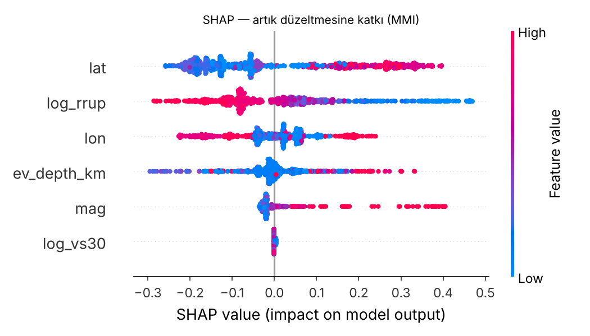
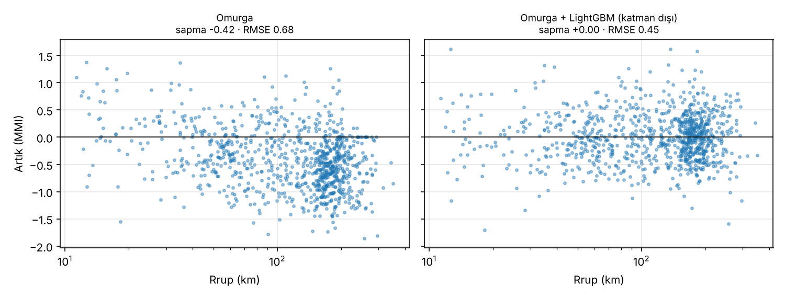

# Aşama 4 — LightGBM artık modeli

`python scripts/train_residual_model.py` ile üretilir. Veri: `results/residuals_koeri_all.csv`
(949 KOERI kaydı, 332 deprem). Omurga: Kale 2015 → WGRW12.

## Katman dışı (out-of-fold) performans

Gruplar: kayıt pencereleri örtüşen depremleri birleştiren `window_group` (5 katlı GroupKFold).
Ayrıca istasyonlar dışarıda bırakılarak (istasyon bazlı GroupKFold) aynı deney tekrarlandı.

| Küme | Omurga | Omurga + sabit kaydırma | Omurga + LightGBM |
|---|---|---|---|
| Tümü (deprem bazlı CV) | 0.68 | 0.54 | **0.45** |
| Tümü (istasyon bazlı CV) | 0.68 | 0.55 | **0.49** |
| Mw ≥ 6 | 0.69 | 0.72 | **0.66** |
| Rrup ≤ 50 km | 0.59 | 0.70 | **0.53** |

(RMSE, MMI. Ayrıntı: `cv_summary.csv`, `cv_folds.csv`.)

## Yorum

- Tek bir sabit kaydırma (veri setinin genel −0.4 MMI sapmasını düzeltmek) tüm kümede RMSE'yi düşürür,
  ancak **büyük depremlerde ve yakın uzaklıklarda kötüleştirir**. Sapma küçük depremlerden gelir;
  LightGBM bunu büyüklük ve uzaklığa bağlı öğrenerek büyük depremleri bozmadan düzeltir.
- SHAP'a göre en büyük katkı **enlem/boylam** (bölgesel yol ve istasyon etkileri) ve **uzaklıktan** gelir.
  İstasyon bazlı CV'de kazanç 0.45 → 0.49'a geriler: öğrenilenin bir kısmı istasyon terimidir ve
  yeni istasyonlara aktarılamaz.
- **Vs30'un katkısı neredeyse sıfırdır** (ortalama |SHAP| ≈ 0.001). Omurga zaten Kale 2015'in zemin terimini
  içerir; USGS vekil Vs30'u ek bilgi taşımamaktadır. Bu, Allen vd. (2012)'nin zemin düzeltmesinden anlamlı
  kazanç bulamamasıyla uyumludur (literatür taraması, boşluk #4).
- Monotonluk kısıtları (Mw ↑, Rrup ↓, Vs30 ↓) sağlanır (`model_card.json`, `monotonic_check`).

## Sınırlamalar

- Mw ≥ 6 için yalnızca 18 deprem / 54 kayıt vardır; büyük depremlerdeki kazanç istatistiksel olarak zayıftır.
- Gözlem enstrümantaldir (PGV → WGRW12). Model, MMI'dan çok PGV artığını öğrenir.
- Uzamsal Gauss süreci (ShakeMap'teki koşullu interpolasyonun karşılığı) henüz eklenmemiştir.

